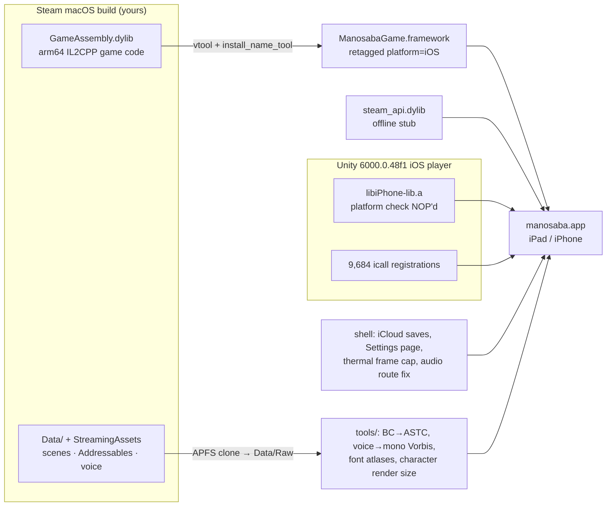

# manosaba from the Steam version, on iPad and iPhone

An alternative to the Switch path in the rest of this repository, for people who own 魔法少女ノ魔女裁判 (manosaba) **on Steam**: it builds an
iOS app from the Steam macOS version (1.1.2) that plays natively and offline on an iPad or iPhone. No console, keys or HLE layer are involved.

The Steam macOS build is IL2CPP: all game code lives in one arm64 `GameAssembly.dylib` that only depends on libSystem, libc++, CoreFoundation,
Foundation and Security, all present on iOS. This directory pairs that original code and data with the matching Unity iOS player (6000.0.48f1)
and converts the data where the iOS player needs it (BC textures to ASTC, voice to compact Vorbis).



Nothing from the game is redistributed: every step reads the Steam install on your Mac, and the result is installed on your own device with
your own developer certificate. All commands below run from this directory (`steam/manosaba`).

Verified on an iPad Pro 11" (2nd generation, A12Z, iPadOS 27) and an iPhone 15 Plus (iOS 27):
- title, new game, story scenes with voice and touch;
- scenes with many characters: 60 fps while the device is cool, a steady 30 fps once it is hot, with the thermal frame cap;
- Steam Cloud saves copied from the Mac load;
- iCloud save sync between the two devices;
- switching between Bluetooth and the built-in speaker;
- 3.27 GB installed, from 8.2 GB of Steam data.

Not verified: every chapter and the movies. Memory peaks at about 2.5 GB, so the increased-memory-limit entitlement stays on.

## How it works

| Piece | What happens |
|---|---|
| Engine | An empty Unity 6000.0.48f1 project is built for iOS (`ShellProject`) to get the iOS player + Xcode trampoline. |
| Platform check | `tools/patch_player_lib.py` NOPs the single `target platform != iOS` branch in `SerializedFile::ReadMetadata` so macOS-built data loads. |
| Game code | `tools/make_game_framework.sh` retags the macOS `GameAssembly.dylib` as iOS (`vtool`), fixes framework install names and wraps it as `ManosabaGame.framework`. |
| Internal calls | `tools/gen_icall_registration.py` registers all 9,684 engine icalls (the shell only registers the 477 it uses). |
| Steam | `tools/gen_steam_stub.py` builds `steam_api.dylib`: init reports failure, restart check says "keep running", everything else returns 0. |
| Data | `tools/stage_data.sh` APFS-clones the Steam `Data/` into the Xcode project (`StreamingAssets` → `Data/Raw`). `SKIP_VOICE=1` drops the 4.3 GB of voice for quick tests. |
| Xcode | `tools/patch_xcode.rb` swaps the il2cpp build step for the two registration files, links and embeds the game framework and the stub. |

Verified so far: data layouts of every engine manager match between the macOS and iOS players of 6000.0.48f1 (byte-for-byte sizes); every symbol the iOS player needs from GameAssembly is exported; the app links.

## Resolution

Measured from the Metal allocations on the devices (`[mtl]` lines of `MetalAllocLogger.mm`):

| Layer | iPad Pro 11" (2nd gen) | iPhone 15 Plus |
|---|---|---|
| Output (drawable, native panel) | 2388×1668 | 2796×1290 |
| Game scene, highest in-game level | 1920×1080, 2× MSAA, scaled to the screen | same |
| Each character (layered render target) | 1125×2250 (75 PPU; the PC build uses 1500×3000) | same |
| Backgrounds / character atlases | 4096×2048 / up to 8192×16384, ASTC | same |

On iOS the game takes its mobile branch, which scales a 1920×1080 reference by `ResolutionCoefficientsForMobile`. `tools/patch_game_config.py` fills that table with 1.0 … 0.5, following the PC levels. So the in-game resolution option gives 1920×1080, 1680×945, 1440×810, 1200×675, 1080×608, 1024×576 and 960×540. Only the top level was measured. On PC the top level is 2560×1440.

A coefficient above 1.0 would render the scene at the iPad's native width (2388×1343), but that is about 55% more pixels, and busy scenes are already GPU-bound on an A12Z.

## Configuration

Everything that identifies you comes from the environment; nothing personal is in the repository.

| Variable | Used by | Meaning |
|---|---|---|
| `MANOSABA_BUNDLE_ID` | `BuildShell.cs`, `make_game_framework.sh`, `tools/devunlock`, `tools/uitest`, `tools/ota/server.py` | Your bundle id (default `com.example.manosaba`) |
| `DEVELOPMENT_TEAM` | `BuildShell.cs`, `xcodebuild`, `tools/drive.sh` | Your Apple developer team id |
| `ICLOUD_CONTAINER` | `tools/patch_xcode.rb` | `iCloud.<bundle id>`, only for iCloud save sync |
| `OTA_BASE` | `tools/ota/server.py` | HTTPS origin the device reaches, for the cable-free install |
| `MANOSABA_SIM` | `tools/sim_run.sh`, `tools/drive.sh` | Default simulator UDID |

## Build

Requirements: Unity 6000.0.48f1 with iOS Build Support, Xcode with the iOS SDK, a paid or free Apple developer account, the Steam macOS build installed.

```sh
# macOS 27 has no Rosetta and Unity 6000.0's package server is x86_64-only:
# clone the editor and run the package server with arm64 node (see tools notes in CHANGELOG).
UNITY=unity-6000.0.48f1/Unity.app/Contents/MacOS/Unity
$UNITY -batchmode -nographics -quit -projectPath ShellProject -buildTarget iOS -executeMethod BuildShell.IOS -logFile logs/build-ios.log

APP="$HOME/Library/Application Support/Steam/steamapps/common/manosaba_game/manosaba.app"
python tools/patch_player_lib.py build/xcode/Libraries/libiPhone-lib.a
python tools/gen_icall_registration.py build/xcode/Libraries/libiPhone-lib.a build/gen/FullICallRegistration.cpp
tools/make_game_framework.sh "$APP/Contents/Frameworks/GameAssembly.dylib" build/gen
python tools/gen_steam_stub.py <GameAssembly arm64 slice> build/gen/steam_api_stub.c   # then clang it to build/gen/steam_api.dylib
tools/stage_data.sh "$APP" build/xcode
python tools/patch_game_config.py build/xcode/Data      # fill the empty mobile resolution table
python tools/transcode_textures.py build/xcode/Data --report logs/transcode.json   # BC -> ASTC, ~4 min
python tools/patch_font_atlases.py build/xcode/Data   # 2048x2048 dynamic CJK font atlases (no upload hitches)
python tools/patch_character_ppu.py build/xcode/Data  # characters render at 75 PPU (1125x2250 targets)
python tools/transcode_audio.py build/xcode/Data --report logs/audio.json   # voice -> mono q45, music q63, ~17 min (needs ffmpeg)
ruby tools/patch_xcode.rb build/xcode build/gen
python tools/make_app_icon.py "$APP" build/xcode   # the game's own icon instead of Unity's default
xcodebuild -project build/xcode/Unity-iPhone.xcodeproj -scheme Unity-iPhone -configuration Release \
  -destination 'id=<device udid>' -allowProvisioningUpdates DEVELOPMENT_TEAM=<team> build
```

Tests: `pytest tests`.

### iCloud save sync (optional)

To share saves between your iPhone and iPad:

1. Create an iCloud container `iCloud.<bundle id>` in the developer account (Certificates, Identifiers & Profiles → Identifiers → iCloud Containers).
2. Attach it to the App ID (App ID → iCloud → Configure).
3. Patch with `ICLOUD_CONTAINER=iCloud.<bundle id> ruby tools/patch_xcode.rb build/xcode build/gen` and build as above.

At launch the app pulls the other device's saves before the game reads them. It pushes its own saves and the game's settings when it goes to the background. To switch devices, send the game to the background on one device, then start it fresh on the other. Look for `[icloud]` in the device console.

## Install without a cable

If the iPad has never been paired over USB, Xcode can't install to it wirelessly (the first pairing needs a cable). The OTA path below only needs the Mac and the device on the same local network, such as home Wi-Fi or a phone hotspot. Nothing is exposed to the internet. iOS installs over the air only from HTTPS with a certificate it trusts; the example gets one from `tailscale serve`, but any HTTPS reverse proxy with a trusted certificate works. Set `OTA_BASE` to its origin.

```sh
# 1. Install page (127.0.0.1:8765), published over HTTPS (here: tailscale serve).
python3 -I tools/ota/server.py &
tailscale serve --https=8443 http://127.0.0.1:8765
```

1. **UDID.** Open `$OTA_BASE/` in Safari on the iPad and tap 读取 UDID. Install the downloaded profile. It posts the UDID back to `logs/ipad-udid.json`. Register that UDID in your developer account, then rebuild with `-allowProvisioningUpdates` so the profile includes the iPad.
2. **Developer Mode (skip if it is already on).** The switch only appears once a development-signed app is on the device. If it isn't on yet, install the placeholder first, so you find out before downloading a game of several GB. It is a shortcut, not a gate: the game button works either way. Build `tools/devunlock` and package it as `build/ota/placeholderunlockdev.ipa`. It's a placeholder of our own with the game's bundle id, about 100 KB, and contains nothing from the game. Tap 安装占位 App on the page, then turn on 设置 → 隐私与安全性 → 开发者模式 and reboot.

   ```sh
   (cd tools/devunlock && xcodegen generate)
   xcodebuild -project tools/devunlock/DevUnlock.xcodeproj -scheme DevUnlock -configuration Release \
     -destination 'generic/platform=iOS' -derivedDataPath build/dd-unlock \
     -allowProvisioningUpdates CODE_SIGN_STYLE=Automatic DEVELOPMENT_TEAM=<team> build
   mkdir -p build/ota/unlock/Payload && /bin/cp -R build/dd-unlock/Build/Products/Release-iphoneos/manosaba.app build/ota/unlock/Payload/
   (cd build/ota/unlock && zip -q -r -y ../placeholderunlockdev.ipa Payload)
   ```

3. **Game.** Package your own build of the game as `build/ota/manosaba.ipa` (`Payload/manosaba.app`, stored uncompressed) and tap 安装游戏 on the page. It replaces the placeholder. Later builds upgrade it in place and keep the save data.

   ```sh
   mkdir -p build/ota/Payload && /bin/cp -cR build/dd/Build/Products/Release-iphoneos/manosaba.app build/ota/Payload/
   (cd build/ota && zip -0 -r -q -y manosaba.ipa Payload)
   ```

   After `transcode_audio.py` the full app with voice is about 3.3 GB (the Steam data is 8.2 GB), so install the full build. `SKIP_VOICE=1` in `stage_data.sh` is still there for quick smoke tests.

Stop both processes when done. `tailscale serve status` should then print `No serve config`.
